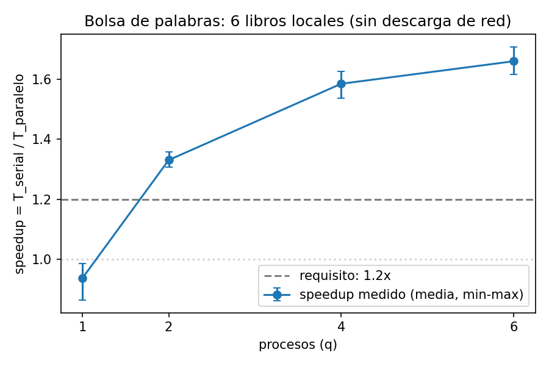

# Evaluación experimental de desempeño

Proyecto Clausura: Bolsa de palabras con MPI. Equipo: Tania Hernandez y Tamara Schnaas.

**Resumen.** La versión MPI supera el speedup mínimo exigido (1.2x) con **q ≥ 2** en todas las
configuraciones probadas: la media va de **1.60x** en q = 2 hasta **2.56x** en q = 8-11, y la
**peor repetición individual** de todo el experimento (30 corridas con q ≥ 2) fue **1.44x**, bien
arriba del mínimo. Con q = 1 el speedup es ~1.0x (sin ganancia, como se espera: un solo proceso no
tiene con quién repartir el trabajo). Una prueba de robustez aparte
([`robustez-sin-libro-dominante.md`](robustez-sin-libro-dominante.md)) confirma que el resultado
no depende de tener un libro mucho más grande que los demás en el corpus. **Pendiente:** todo esto
se midió con libros locales (sin red); falta una corrida con descarga real desde Project
Gutenberg (bloqueada por mantenimiento del sitio al momento de escribir esto — ver el README).

| Archivo | Contenido |
|---|---|
| [`experiments/corridas_locales.txt`](../experiments/corridas_locales.txt) | Las 35 corridas crudas (salida de `bolsa_mpi`), una por `q` y repetición |
| [`experiments/resultados_locales.csv`](../experiments/resultados_locales.csv) | Resumen: media, mínimo y máximo del speedup por `q` |
| [`experiments/speedup_locales.png`](../experiments/speedup_locales.png) | Gráfica de esta tabla |
| [`robustez-sin-libro-dominante.md`](robustez-sin-libro-dominante.md) | Prueba aparte: ¿se mantiene el speedup sin un libro dominante en el corpus? |

## 1. Definición del experimento

### Qué se varía

| Parámetro | Valores |
|---|---|
| Número de procesos `q` | 1, 2, 3, 4, 6, 8, 11 |
| Repeticiones | **5** por valor de `q`, se reporta media, mínimo y máximo |

`q = 11` es el máximo posible en la máquina de prueba: `nproc` reporta 22, pero son **11 núcleos
físicos** con hyperthreading (2 hilos por núcleo); Open MPI cuenta núcleos físicos y rechaza
`-np` mayor a 11 ("not enough slots").

### Qué se deja fijo

- **Corpus:** 6 "libros" locales derivados de `temas/pg100.txt` (obras completas de Shakespeare),
  generados por `data/preparar_libros_locales.sh` en `data/urls_locales.txt`. Uno de los 6 pesa
  mucho más que los otros cinco juntos (4.1 de 5.4 MB), como pasa con `pg100` dentro de
  `data/urls.txt` — un libro local en vez de descargarlo evita los bloqueos temporales (503) de
  Gutenberg y hace que las 35 corridas sean reproducibles sin depender de la red.
- **`TROZO = 256 * 1024`** (tamaño de los trozos en los que se parte cada libro para repartir el
  conteo). Se probó entre 16 KB y 512 KB sin diferencia apreciable (ver
  [`descripcion-codigo.md`](descripcion-codigo.md), sección 4b); se usó el valor por defecto del
  código en las 35 corridas.
- **Compilación:** `g++`/`mpic++ -O2 -std=c++17`, igual en ambos binarios, así la diferencia de
  tiempo viene del algoritmo y del reparto de trabajo, no del compilador.
- k = 6 libros en todas las corridas (el programa funciona para cualquier k; no se varió aquí
  porque el enunciado pide medir el efecto de **q**, no de k).

### Qué se mide

`bolsa_mpi` corre, en una sola ejecución, la versión serial (rank 0) y luego la paralela (todos
los procesos), y mide ambas con `MPI_Wtime()`:

- **`T_serial`** y **`T_paralelo`**: tiempo total (descarga + procesamiento) de cada versión.
- **Speedup total** = `T_serial / T_paralelo`: la métrica principal, porque el enunciado dice que
  el programa descarga los libros dinámicamente.
- **Speedup de procesamiento**: igual pero sin la descarga, para ver cuánto del speedup viene de
  paralelizar el conteo (que se reparte por trozos, balanceado) contra la descarga (que se
  reparte por libro, menos balanceada, y pesa más cuando hay red real).
- **Tiempo de unión** (`p_union`): cuánto tarda el proceso 0 en sumar los conteos, armar el
  vocabulario y escribir el CSV — la parte serial que ningún `q` puede acelerar (límite de
  Amdahl). En las 35 corridas está entre 0.045 s y 0.065 s en promedio por `q`; no crece con `q`
  (tiene sentido: es trabajo de un solo proceso sobre el mismo total de datos).
- **Matrices idénticas**: cada corrida de `bolsa_mpi` compara su matriz paralela contra la serial
  de esa misma ejecución. Las **35 corridas dieron matrices idénticas**; además, el CSV de
  `bolsa_serial` (corrida aparte) y el de `bolsa_mpi` se compararon contra la matriz "esperada"
  de `data/validar_sklearn.py` (`CountVectorizer` de sklearn con el mismo patrón de tokenización):
  también idénticas, 23,655 palabras de vocabulario.

### Cómo se corrió

```bash
bash data/preparar_libros_locales.sh        # genera data/urls_locales.txt (una sola vez)
for q in 1 2 3 4 6 8 11; do
  for rep in 1 2 3 4 5; do
    mpirun -np $q ./bolsa_mpi data/urls_locales.txt salida_mpi.csv
  done
done
python3 experiments/analizar_corridas.py    # resume y grafica
```

## 2. Resultados

| q | speedup media | speedup mínimo | speedup máximo | T_serial (s) | T_paralelo (s) |
|---|---|---|---|---|---|
| 1 | 1.05 | 0.88 | 1.23 | 0.303 | 0.295 |
| 2 | 1.60 | 1.44 | 1.99 | 0.276 | 0.174 |
| 3 | 2.07 | 1.83 | 2.23 | 0.255 | 0.125 |
| 4 | 2.14 | 1.95 | 2.34 | 0.236 | 0.111 |
| 6 | 2.33 | 2.19 | 2.60 | 0.268 | 0.115 |
| 8 | 2.55 | 2.32 | 3.29 | 0.282 | 0.112 |
| 11 | 2.56 | 2.27 | 2.85 | 0.297 | 0.117 |

(tabla completa, con el speedup de solo procesamiento y el tiempo de unión, en
[`experiments/resultados_locales.csv`](../experiments/resultados_locales.csv))



**Lectura:** el speedup sube rápido de q = 1 a q = 4 (donde ya se gana más de 2x), sigue subiendo
más despacio hasta q = 8, y se aplana entre q = 8 y q = 11. Dos razones para el aplanamiento:
(1) la máquina tiene 11 núcleos físicos, así que arriba de ahí ya no hay más paralelismo real de
hardware; (2) con solo 6 libros y ~5.4 MB de texto total, repartir entre más procesos reparte
trozos cada vez más chicos, y el costo fijo de `MPI_Alltoallv`/`MPI_Gatherv` (que no depende del
tamaño de los datos sino de cuántos procesos participan) empieza a pesar más en proporción. Esto
es justo lo que predice la ley de Amdahl: con una parte serial fija (la unión, sección 1), hay un
techo al speedup que ningún aumento de `q` puede superar, y ese techo se nota más entre pocos
procesos cuando el trabajo paralelizable total es chico.

## 3. Qué falta (y por qué no está aquí)

- **Descarga real desde Project Gutenberg**: el enunciado pide que los libros se descarguen
  dinámicamente, así que una corrida con red real es necesaria para la entrega final. No se hizo
  todavía: Gutenberg devolvió "Temporarily Down for Maintenance" (503, `Retry-After` de varias
  horas) la primera vez que se intentó verificar las URLs. Cuando el sitio esté disponible, se
  agregará una sección con esa corrida (una sola, para no arriesgar otro bloqueo por exceso de
  peticiones) y su salida se guardará en `experiments/corridas_red.txt`.
- **Verificación de las URLs de `data/urls.txt`**: por el mismo motivo, todavía no se confirmó
  que las 7 URLs abren los libros correctos (ver README).
