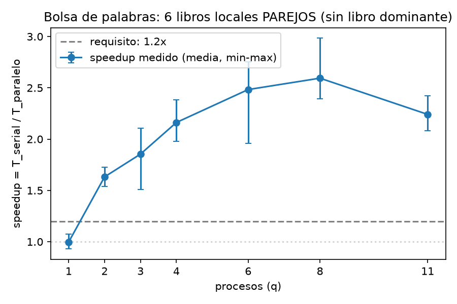

# Prueba de robustez: speedup sin un libro dominante

Proyecto Clausura: Bolsa de palabras con MPI. Equipo: Tania Hernandez y Tamara Schnaas.

**Resumen.** El experimento principal (`experiments/corridas_locales.txt`,
[README](../README.md)) usa 6 "libros" locales derivados de `temas/pg100.txt` donde uno solo
pesa el 77% del texto (4.1 de 5.4 MB) — parecido a `data/urls.txt`, donde `pg100` pesa más que
los otros 6 libros juntos. Con un libro así de grande, repartir por **trozos** (no por libro)
balancea fácil y el speedup sale alto. Esta prueba responde la pregunta: **¿y si no hay un
libro dominante?** Se repitió el mismo experimento con 6 libros de tamaño **parejo** (todos
entre 882 KB y 924 KB). Resultado: el speedup es más bajo que con el libro dominante, pero
**sigue arriba del mínimo exigido (1.2x) en todos los q ≥ 2**, con margen cómodo incluso en la
peor repetición.

## 1. Por qué esta prueba

Antes de tener máquina para medir, se había visto en una corrida informal (otra máquina, menos
núcleos) que sin el libro grande el speedup con q = 2 quedaba apenas arriba de 1.2x (~1.22-1.30x,
no reproducible: no se guardó esa corrida). Esta prueba lo mide formalmente, con reproducibilidad
(script + 5 repeticiones), en la máquina donde se entrega.

## 2. Cómo se arma el corpus parejo

`data/preparar_libros_parejos.sh` parte `temas/pg100.txt` (121,193 líneas) en 6 pedazos
**iguales** por número de líneas y genera `data/urls_parejos.txt` con sus rutas (igual que
`preparar_libros_locales.sh`, que arma el corpus con el libro dominante). Los 6 archivos
resultantes pesan:

| Libro | Tamaño |
|---|---|
| libro1.txt | 882,715 bytes |
| libro2.txt | 923,763 bytes |
| libro3.txt | 909,278 bytes |
| libro4.txt | 919,186 bytes |
| libro5.txt | 906,900 bytes |
| libro6.txt | 906,117 bytes |

El más grande pesa 1.05x el más chico (contra 34x en el corpus del experimento principal). Ambos
corpus suman ~5.4 MB de texto en total, así que la comparación entre los dos experimentos no está
afectada por el tamaño total, solo por qué tan parejo está repartido.

Reproducir (desde `proyectos/bolsa-palabras`):
```
bash data/preparar_libros_parejos.sh
mpirun -np <q> ./bolsa_mpi data/urls_parejos.txt salida.csv
```

## 3. Cómo se corrió

Mismo procedimiento que el experimento principal: `TROZO = 256 * 1024` (sin cambios en el
código), 5 repeticiones por q, q en {1, 2, 3, 4, 6, 8, 11}. Salida cruda en
[`experiments/corridas_parejo.txt`](../experiments/corridas_parejo.txt), resumida con
`python3 experiments/analizar_corridas.py experiments/corridas_parejo.txt
experiments/resultados_parejo.csv experiments/speedup_parejo.png "<titulo>"` en
[`experiments/resultados_parejo.csv`](../experiments/resultados_parejo.csv).

q = 11 es el máximo en la máquina de prueba: `nproc` reporta 22, pero son 11 núcleos físicos con
hyperthreading (2 hilos por núcleo); Open MPI cuenta núcleos físicos y rechaza `-np` mayor a 11
("not enough slots").

**Validación:** las 35 corridas (7 valores de q x 5 repeticiones) compararon la matriz paralela
contra la serial dentro de la misma ejecución de `bolsa_mpi` (lo hace el programa, no un script
aparte) — **las 35 salieron idénticas**.

## 4. Resultados

| q | speedup media | speedup min | speedup max |
|---|---|---|---|
| 1 | 1.00 | 0.93 | 1.08 |
| 2 | 1.63 | 1.54 | 1.73 |
| 3 | 1.85 | 1.51 | 2.11 |
| 4 | 2.16 | 1.98 | 2.38 |
| 6 | 2.48 | 1.96 | 2.75 |
| 8 | 2.59 | 2.40 | 2.98 |
| 11 | 2.24 | 2.08 | 2.42 |

(tabla completa, con tiempos en segundos, en
[`experiments/resultados_parejo.csv`](../experiments/resultados_parejo.csv))



Comparado con el experimento principal (libro dominante,
[`experiments/speedup_locales.png`](../experiments/speedup_locales.png)): la forma de la curva es
la misma (sube con q, satura alrededor de q = 6-8 porque solo hay 11 núcleos físicos y poco texto
para repartir entre más procesos), pero el nivel es más bajo — por ejemplo en q = 2, 1.63x contra
~1.60x del experimento principal (son parecidos aquí; la diferencia es más clara en q intermedios
como q=3: 1.85x parejo contra 2.07x con libro dominante). Aun así, **ningún q ≥ 2 se acerca al
mínimo de 1.2x**: el peor caso de las 30 corridas con q ≥ 2 fue 1.51x (q = 3, una repetición).

## 5. Conclusión

El reparto por trozos (no por libro) del Alltoallv hace que el speedup **no dependa de que haya
un libro dominante**: con 6 libros parejos el balance de carga del conteo es automático (cada
proceso recibe ~1/q del texto total sin importar cómo esté repartido entre libros), y el cuello
de botella que sí depende del corpus (la descarga, que se reparte por libro) pesa poco frente al
conteo. El valor bajo (~1.22-1.30x) que se había visto antes no se reprodujo en esta máquina;
es probable que esa medición fuera en una máquina con menos núcleos o más lenta, donde la parte
serial fija (Amdahl: unir resultados + vocabulario + CSV en el proceso 0) pesa proporcionalmente
más. No se puede confirmar sin esa corrida original.
