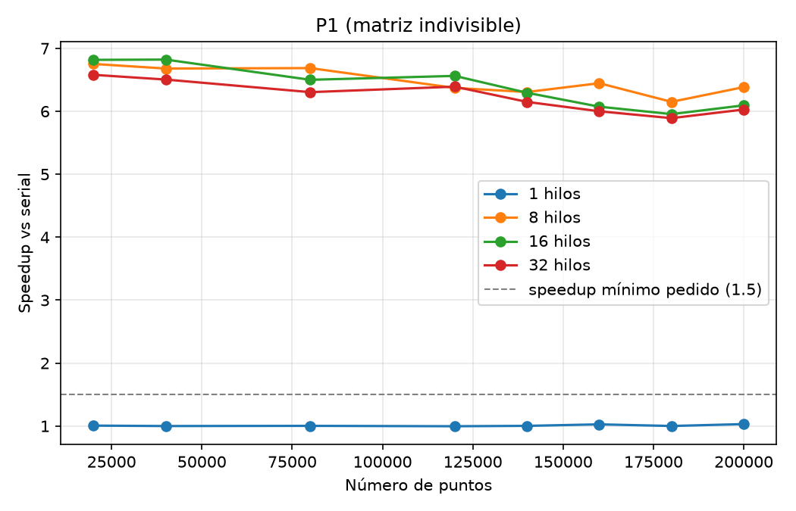
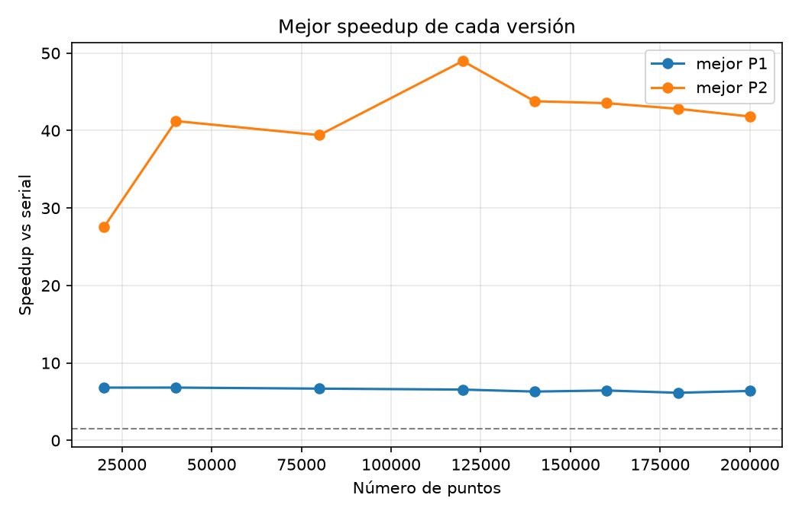
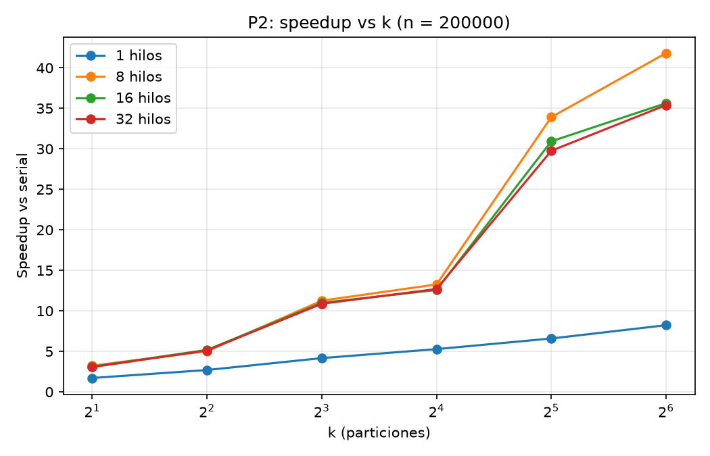

**Resumen.** Las dos versiones paralelas superan el speedup mínimo de 1.5 en **todas** las
configuraciones con más de un hilo. **P1** llega a **~6.4×** con 8 hilos y se queda ahí: no puede pasar
del número de cores físicos. **P2** llega a **41.8×** con n = 200,000 (máximo: **49.0×** con
n = 120,000), porque además de repartir el trabajo **hace menos trabajo**. Las tres versiones dan
exactamente las mismas etiquetas.

| Archivo de datos | Contenido |
|-----------------------------------|-----------------------------------|
| [`experiments/resultados_crudos.csv`](../experiments/resultados_crudos.csv) | Las 2,320 corridas, una por fila: `version, n_points, hilos, k, repeticion, tiempo_segundos` |
| [`experiments/resultados.csv`](../experiments/resultados.csv) | 232 configuraciones: promedio de las 10 repeticiones y speedup contra la serial |
| [`experiments/graficas/`](../experiments/graficas/) | Gráficas de speedup (PNG) |

---

## 1. Definición del experimento

### Qué se varía (p14)

| Parámetro | Valores | Aplica a |
|---------------|---------------------------------------------|----------|
| Número de puntos `n` | 20,000; 40,000; 80,000; 120,000; 140,000; 160,000; 180,000; 200,000 | Serial, P1, P2 |
| Número de hilos | {1, virtuales/2, virtuales, virtuales×2} = **{1, 8, 16, 32}** | P1, P2 |
| Particiones `k` | {2, 4, 8, 16, 32, 64} | Solo P2 |
| Repeticiones | **10** por configuración, se reporta el **promedio** | Todas |

Esto da 8 configuraciones de la serial, 8 × 4 = 32 de P1 y 8 × 4 × 6 = 192 de P2: **232
configuraciones y 2,320 corridas**.

### Qué se deja fijo
- `eps = 0.03` y `min_samples = 10`, los valores del notebook del curso.
- **Datos de entrada.** `experiments/generar_datos.py` genera `<n>_data.csv` igual que la celda 1 de
  `DBSCAN_noise.ipynb` (p14): `make_blobs` con 4 centros, `cluster_std = 0.06`, `random_state = 11`,
  coordenadas redondeadas a 3 decimales. Con la semilla fija, todas las versiones procesan
  **exactamente el mismo archivo** para cada `n`.
- **Compilación.** Las tres versiones se compilan con las mismas banderas (`-O2`), así que la
  diferencia de tiempo viene del algoritmo y no del compilador.

### Qué se mide
- **Tiempo:** `omp_get_wtime()` alrededor del algoritmo. En la serial y en P1 cubre los dos pasos. En
  P2 empieza **antes** de armar las celdas y los halos, para que ese trabajo extra también cuente. No
  se mide leer ni escribir el CSV, que es igual en las tres versiones.
- **Speedup** = tiempo promedio de la serial / tiempo promedio de la versión paralela, con el
  **mismo** `n` (nota 01, p87–p92).
- **Eficiencia** = speedup / hilos. Se usa solo para P1 (nota 01).

### Cómo se corrió
`experiments/correr_experimento.py` automatiza todo:

1. Compila serial, P1 y P2 y genera los 8 archivos de entrada.
2. Corre cada configuración 10 veces, una corrida a la vez, para que dos corridas no compitan por los
   cores.
3. **Valida en cada configuración:** en la primera repetición compara las etiquetas contra las de la
   serial y se detiene si hay **una sola** diferencia. El experimento terminó sin detenerse, así que
   P1 y P2 dan las mismas etiquetas que la serial en las 224 configuraciones paralelas.
4. Guarda cada corrida en cuanto termina, así que se puede interrumpir y reanudar.
5. Al final promedia las repeticiones en `resultados.csv`. `graficar.py` genera las gráficas.

Para reproducir, desde la raíz del repo:

```bash
.venv/bin/python proyectos/dbscan/experiments/correr_experimento.py
.venv/bin/python proyectos/dbscan/experiments/graficar.py
.venv/bin/python proyectos/dbscan/experiments/analizar_celdas.py      # sección 4.2
```

---

## 2. Equipo utilizado

| | |
|---------------------|-------------------------------------------------|
| Equipo | MacBook Pro (Intel) |
| CPU | Intel Core i9-9880H @ 2.30 GHz |
| Cores físicos / virtuales | **8 / 16** (Hyper-Threading: 2 hilos de hardware por core) |
| Caché | L2 de 256 KB por core, L3 de 16 MB compartida |
| RAM | 16 GB |
| Sistema operativo | macOS 26.6.2 (build 25G83) |
| Compilador | Apple clang 21.0.0 (`clang-2100.1.1.101`), x86_64 |
| OpenMP | `libomp` 23.1.3 de Homebrew |
| Banderas | `clang++ -std=c++17 -O2 -Xpreprocessor -fopenmp -I/usr/local/opt/libomp/include -L/usr/local/opt/libomp/lib -lomp` |
| Python (scripts) | 3.14.7, con numpy, pandas, matplotlib y scikit-learn |

Apple clang no acepta `-fopenmp` directo, por eso se usan `-Xpreprocessor -fopenmp` y se enlaza
`libomp` a mano (nota 02, "Cómo compilar en tu Mac").

---

## 3. Resultados

### 3.1 Tiempo de la serial (línea base)

| n | 20k | 40k | 80k | 120k | 140k | 160k | 180k | 200k |
|---------------|------|------|------|-------|-------|-------|-------|-------|
| Tiempo (s) | 0.27 | 1.10 | 4.38 | 10.12 | 13.43 | 17.94 | 22.32 | 28.09 |

Al duplicar n, el tiempo se multiplica por ~4 (20k $\rightarrow$ 40k: ×4.02; 40k $\rightarrow$ 80k: ×4.00; 80k $\rightarrow$ 160k:
×4.09). Es el **O(n²)** del algoritmo ingenuo (nota 03 §6).

### 3.2 P1: matriz indivisible

{width=88%}

| n | 1 hilo | 8 hilos | 16 hilos | 32 hilos |
|---|---|---|---|---|
| 20,000 | 1.01 | 6.75 | **6.82** | 6.58 |
| 40,000 | 1.00 | 6.68 | **6.82** | 6.50 |
| 80,000 | 1.00 | **6.69** | 6.50 | 6.30 |
| 120,000 | 1.00 | 6.37 | **6.56** | 6.39 |
| 140,000 | 1.00 | **6.31** | 6.29 | 6.15 |
| 160,000 | 1.03 | **6.45** | 6.07 | 6.00 |
| 180,000 | 1.00 | **6.15** | 5.96 | 5.89 |
| 200,000 | 1.03 | **6.38** | 6.09 | 6.03 |

Speedup contra la serial. En negritas, el mejor de cada fila.

### 3.3 P2: matriz dividida en k

{width=88%}

{width=88%}

Speedup de P2 con **n = 200,000**:

| Hilos | k = 2 | k = 4 | k = 8 | k = 16 | k = 32 | k = 64 |
|---|---|---|---|---|---|---|
| 1 | 1.71 | 2.70 | 4.17 | 5.28 | 6.59 | 8.23 |
| 8 | 3.23 | 5.03 | 11.26 | 13.26 | 33.91 | **41.82** |
| 16 | 3.12 | 5.18 | 10.99 | 12.58 | 30.93 | 35.63 |
| 32 | 3.06 | 5.11 | 10.87 | 12.70 | 29.76 | 35.40 |

Mejor configuración de P2 para cada n. **En los 8 tamaños es la misma: 8 hilos y k = 64.**

| n | 20k | 40k | 80k | 120k | 140k | 160k | 180k | 200k |
|-------------|-------|-------|-------|-----------|-------|-------|-------|-------|
| Speedup | 27.5 | 41.2 | 39.4 | **49.0** | 43.8 | 43.5 | 42.8 | 41.8 |
| Tiempo (s) | 0.010 | 0.027 | 0.111 | 0.207 | 0.307 | 0.412 | 0.521 | 0.672 |

Hay una gráfica por cada k, con una línea por número de hilos, en
`experiments/graficas/speedup_p2_k<k>.png`.

### 3.4 Variabilidad entre repeticiones

El coeficiente de variación (desviación estándar / promedio) de las 10 repeticiones tiene una
**mediana de 2.1%**, y en el 75% de las configuraciones es menor a 3.9%. Los casos más altos se deben
a **una sola corrida lenta** entre las 10, probablemente por otro proceso de la Mac que se atravesó.
Dos ejemplos:

- Serial con n = 200,000: nueve corridas entre 27.1 y 27.6 s, y una de **34.3 s**. Sube el promedio
  a 28.09 s y por eso P1 con 1 hilo sale 1.03× "más rápida" que la serial, aunque hace exactamente
  lo mismo.
- P2 con n = 80,000, 8 hilos y k = 64: nueve corridas de ~0.095–0.111 s y una de 0.223 s
  (CV = 36%).

Se reportan los promedios tal como los pide la p14, sin quitar valores atípicos. Ninguna conclusión
de este documento cambia por ellos.

---

## 4. Interpretación y análisis

### 4.1 P1: escala hasta los cores físicos y ahí se queda

**Con 8 hilos, P1 llega a ~6.4× (eficiencia ~0.80).** Era lo esperado: el Paso 1 son n² distancias
independientes sobre arreglos que caben en caché (`x` y `y` de 200,000 `double` pesan 3.2 MB y la L3
es de 16 MB). El algoritmo está limitado por **cómputo**, no por memoria (nota 03 §6), así que cada
core trabaja casi sin esperar.

**¿Por qué no llega a 8×?** Lo atribuimos a dos causas:
- **No es la parte serial (Amdahl).** Lo único que no está paralelizado dentro del cronómetro es la
  copia `es_core_paso1`, que es O(n) frente a O(n²). Con f $\approx$ 1, Amdahl no explica la pérdida.
- **Hipótesis, no medida:** el i9-9880H sube su frecuencia (Turbo Boost) cuando trabaja un solo
  core y la baja cuando trabajan los 8, por consumo y temperatura. Entonces la serial corre a una
  frecuencia más alta que cada hilo de P1. Esto también explicaría por qué el speedup baja un poco
  con n grande (6.75 $\rightarrow$ 6.38 con 8 hilos): las corridas largas calientan más el procesador. Para
  confirmarlo habría que registrar la frecuencia durante las corridas.

**¿Por qué 16 hilos no ayuda?** Los 16 cores virtuales son 8 físicos con Hyper-Threading. Los dos
hilos de un mismo core comparten sus unidades de punto flotante, que es justo lo que este ciclo
satura. Hyper-Threading ayuda cuando un hilo se detiene esperando memoria (nota 01, tabla del
equipo), y aquí casi no hay esas esperas. Con n $\leq$ 40,000, 16 hilos gana por muy poco (6.82 contra
6.75); con n $\geq$ 140,000, pierde un poco.

**¿Por qué 32 hilos es lo peor?** Hay más hilos que hilos de hardware, así que el sistema operativo
tiene que turnarlos. Eso agrega cambios de contexto sin agregar paralelismo (nota 01: "Qué esperar
con 32 hilos").

### 4.2 P2: el speedup viene de dos fuentes que se multiplican

P2 llega a ~42× en una máquina de 8 cores. Eso **no** es "speedup superlineal" por paralelismo: P2
gana por dos razones distintas, y las podemos separar.

```
speedup de P2  =  (cuánto trabajo se ahorra)  ×  (cuánto se reparte entre hilos)
               =   speedup con 1 hilo         ×  tiempo con 1 hilo / tiempo con h hilos
```

**Fuente 1: menos trabajo.** Cada punto se compara solo contra los candidatos de su celda (propios +
halo), no contra los n puntos. `analizar_celdas.py` cuenta cuántas distancias hace el Paso 1 de P2
para cada k, sin cronometrar nada. El cociente n² / (distancias de P2) predice casi exacto el
speedup **medido con 1 hilo**:

| k | 2 | 4 | 8 | 16 | 32 | 64 |
|------------------------------------------|------|------|------|------|------|------|
| n² / distancias de P2 (contado) | 1.67 | 2.63 | 4.06 | 5.15 | 6.47 | 8.13 |
| Speedup con 1 hilo (medido, n = 200k) | 1.71 | 2.70 | 4.17 | 5.28 | 6.59 | 8.23 |

La reducción no llega a k (por ejemplo, 8.1 y no 64 con k = 64) porque **los puntos no están
repartidos parejo**. El trabajo de una celda es (propios) × (candidatos), y las celdas que caen sobre
un blob tienen muchos puntos en ambos factores. Con k = 64, 9 de las 64 celdas están vacías y una
sola tiene el 14.7% del trabajo total.

**Fuente 2: paralelismo, limitado por la celda más cargada.** El `parallel for` reparte **celdas**,
no puntos. Un paso no termina hasta que acaba la celda más pesada, así que el desbalance pone un
techo. Si se reparten las celdas entre 8 hilos dándole cada celda, de mayor a menor, al hilo menos
cargado (más o menos lo que hace `schedule(dynamic, 1)`), sale este límite:

| k | 2 | 4 | 8 | 16 | 32 | 64 |
|----------------------------------------------|------|------|------|------|------|------|
| Trabajo de la celda más cargada | 52% | 49% | 34% | 37% | 15% | 15% |
| Límite del paralelismo con 8 hilos (calculado) | 1.92 | 2.04 | 2.97 | 2.74 | 6.88 | 6.79 |
| Tiempo con 1 hilo / tiempo con 8 hilos (medido) | 1.89 | 1.86 | 2.70 | 2.51 | 5.15 | 5.08 |

El modelo explica lo que se ve en las gráficas:
- **Con k = 2 o 4 el paralelismo no pasa de ~2×.** Con k = 2 solo hay 2 iteraciones en el
  `parallel for`, así que 6 de los 8 hilos no hacen nada (p48 de OpenMP). Con k = 4, dos celdas
  tienen casi la mitad del trabajo cada una.
- **k = 16 escala peor que k = 8** (2.51 contra 2.70). Con la cuadrícula de 4 × 4, un blob queda
  casi entero en una celda, que concentra el 37% del trabajo.
- **El salto grande es de k = 16 a k = 32**: la celda más pesada baja de 37% a 15% del trabajo y el
  paralelismo pasa de ~2.5× a ~5×.
- Lo medido queda **siempre por debajo** del límite. El modelo no cuenta el Paso 2, el armado de
  halos ni la baja de frecuencia con 8 cores que vimos en P1. Además, `dynamic` reparte en el orden
  de las celdas, no de mayor a menor.

Multiplicando las dos fuentes con k = 64: 8.23 × 5.08 $\approx$ **41.8×**, el speedup medido.

**¿Por qué P2 rinde mejor con 8 hilos que con 16 o 32?** Con P1, que tiene miles de iteraciones
iguales, pasar de 8 a 16 hilos casi no cambia nada. En P2 sí duele (41.8× contra 35.6× con k = 64),
porque el tiempo lo marca **una sola celda grande**. Nuestra explicación, no medida directamente: con
más de 8 hilos, el hilo que procesa esa celda puede compartir su core físico con otro hilo
(Hyper-Threading) y avanzar más lento, y la celda más pesada es la que retrasa a todos.

**¿Por qué con n = 20,000 el speedup de P2 es menor (27.5×)?** La reducción de trabajo casi no
depende de n: `analizar_celdas.py 20000` da 8.09 con k = 64, contra 8.13 con n = 200k. Lo que cambia
es lo demás:
- Cada corrida dura ~10 ms, así que el costo fijo de crear los hilos y armar los halos (O(k·n))
  pesa más. Con 1 hilo, P2 logra 6.50× y no los 8.09× que predice el conteo.
- Con menos puntos el desbalance es peor: la celda más cargada tiene el 17% del trabajo, contra
  15% con n = 200k. El límite del paralelismo con 8 hilos baja de 6.79 a 5.86, y lo medido baja de
  5.08 a 4.24.

De 40k en adelante, el speedup de P2 con 8 hilos y k = 64 se mueve entre 39× y 49×, sin una
tendencia clara. El pico de 49× con n = 120,000 lo tomamos como parte de esa variación, no como un
efecto real.

### 4.3 ¿Por qué P2 fue mejor que P1?

**P2 fue mejor que P1 en todas las configuraciones con k $\geq$ 8 y 8 hilos o más.** Con k = 2 y k = 4,
P1 gana con 8 hilos o más (6.4× contra 3.2× y 5.0× con n = 200k), porque con tan pocas celdas P2 no
puede usar todos los hilos.

| | P1 | P2 (k = 64) |
|----------------------|-----------------|-------------------------------|
| Distancias del Paso 1 (n = 200k) | n² = 4.0 × $10^{10}$ | 4.9 × $10^{9}$ (8.1 veces menos) |
| Paralelismo con 8 hilos | ~6.4× | ~5.1× (limitado por la celda más cargada) |
| **Speedup total** | **~6.4×** | **~41.8×** |
| Techo | ~número de cores físicos | Crece con k mientras el desbalance lo permita |

La razón principal **no es que P2 paralelice mejor**. P1 aprovecha mejor los hilos (6.4× contra
5.1×), porque reparte n iteraciones iguales y P2 reparte k celdas desiguales. P2 gana porque **hace
mucho menos trabajo**: la partición del plano, que la p11 plantea como forma de dividir la matriz,
funciona también como un índice espacial. Un punto ya no se compara contra puntos que están del
otro lado del plano y que nunca podrían ser sus vecinos.

Por eso el speedup de P2 sigue subiendo con k (gráfica de speedup contra k). Con k mayor que 64 la
reducción seguiría creciendo, pero el halo crecería en proporción: con celdas más angostas que eps,
el halo sería más grande que la propia celda. El experimento no probó esos valores de k.

### 4.4 Conclusiones

1. **Requisito de speedup > 1.5 (p15): cumplido** por ambas versiones en todas las configuraciones
   con más de un hilo. El peor caso es P2 con k = 2 y 16 hilos con n = 20,000: **1.80×**.
2. **Correctitud:** P1 y P2 dan exactamente las mismas etiquetas que la serial en las 224
   configuraciones paralelas. A su vez, la serial coincide con el DBSCAN de scikit-learn (ver
   `code-description.md`).
3. **La configuración de hilos recomendada en esta Mac es 8 = cores físicos.** Hyper-Threading no
   ayuda en un problema limitado por cómputo, y usar más hilos que hilos de hardware empeora.
4. **El mejor resultado no viene solo de agregar hilos.** Viene de combinar el paralelismo con un
   algoritmo que hace menos trabajo, y está limitado por qué tan parejo se reparte ese trabajo.

---

## 5. Uso responsable y ético de IA Generativa

La p12 pide seguir los lineamientos de IEEE y de Elsevier para el uso de IA generativa y recuerda que
**"el uso de un LLM no exime de la responsabilidad de entender al 100% el código entregado"**. De
esos lineamientos tomamos tres principios:

- **Transparencia:** declarar qué herramienta se usó y para qué.
- **Responsabilidad de los autores:** la IA no es autora. Las autoras responden por todo el contenido
  y lo revisaron.
- **Verificación:** no aceptar sin comprobar lo que produce la herramienta: el código se prueba y las
  afirmaciones se contrastan con las fuentes.

**Herramienta usada:** Claude (Anthropic), a través de Claude Code, en este repositorio.

**Para qué se usó:**

| Parte del proyecto | Uso |
|------------------------------|----------------------------------------|
| Notas de estudio (`temas/*/NN-notas.md`) | Resumir las diapositivas del curso, citando la página de cada concepto. |
| Código (serial, P1, P2) | **[POR COMPLETAR]** completar qué partes escribieron ustedes y en cuáles hubo apoyo de la IA. |
| Scripts del experimento (`experiments/*.py`) | Automatizar las 2,320 corridas, la validación de etiquetas, los promedios y las gráficas. |
| Documentación (`docs/*.md`) | Borradores de la descripción del código y de este análisis, que después revisamos y corregimos. |
| Análisis de resultados | Separar el speedup de P2 en "menos trabajo" y "paralelismo" con `analizar_celdas.py`. |

**Cómo verificamos el resultado:**
- **Las etiquetas no se dan por buenas:** la serial se comparó contra scikit-learn (0 diferencias), y
  P1 y P2 contra la serial en **cada** configuración del experimento.
- **Los números de este documento vienen de corridas reales** en la Mac descrita en la sección 2
  (`resultados_crudos.csv`). Las afirmaciones que no medimos están marcadas como **hipótesis**.
- **Cada justificación de diseño cita la diapositiva o la nota** de donde viene. Las decisiones que
  no vienen de clase (por ejemplo, la copia contigua de los candidatos en P2) dicen que se
  justificaron midiendo.
- **Entender al 100% el código:** **[POR COMPLETAR]** confirmar que ambas practicaron explicar línea por
  línea serial, P1 y P2, con las preguntas de defensa de `code-description.md`.

> **[POR COMPLETAR]** revisar esta sección en equipo y ajustarla a cómo usaron la herramienta en realidad.
> Es una declaración personal y la tienen que firmar ustedes.

